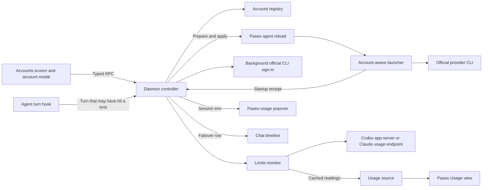
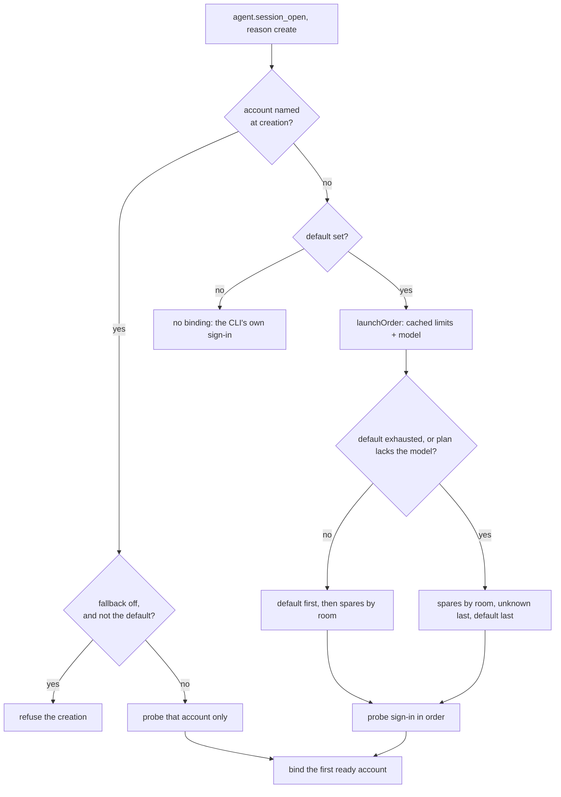
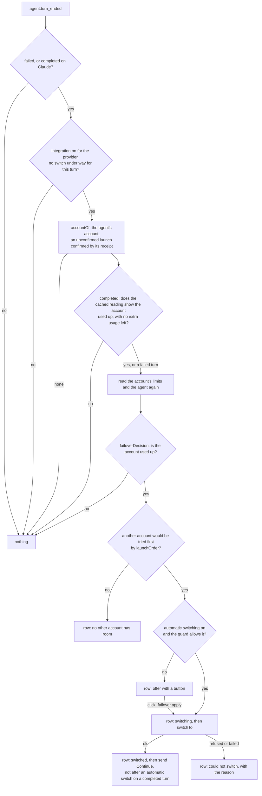

# Architecture and data

[Back to the README](../README.md)

Account Switcher is an independent plugin for Paseo 0.11.x through 0.14.x, including beta releases after 0.11.0. It uses public plugin and provider APIs; no Paseo core patch is required. The development SDK is pinned to 0.11.4, the oldest supported release, so typechecking shows the plugin uses only the 0.11 API. The screen API and the usage source are 0.11 APIs, so every supported release has them. The plugin still checks for them at runtime, falling back to the older surface API or skipping the usage source; on a supported host these checks are defensive and change nothing.

## Runtime boundaries

- `index.client.tsx` and `client/` provide React Native UI, host-themed components, the composer chip, the host's modal, and the timeline rows. TanStack Query caches are scoped to the selected daemon.
- `client/screens.ts` registers the Accounts screen. It uses `addScreen` and, for the sidebar row, `addSidebarHeaderItem` with the host's `SidebarRow`; when the app lacks either, it uses the deprecated `addSurface` or `addSidebarItem` for that part. Each choice is a feature check on the app object, not a version comparison. The Command Center item opens the screen with `openScreen`, or `openSurface` on an app without it. Both paths show the same component.
- `index.server.ts` and `server/controller.ts` register RPCs, agent lifecycle hooks (`agent.create`, `agent.session_open`, `agent.created`, `agent.turn_ended`), and the usage source. The controller owns profiles, login reservations, switching, integration, and monitoring.
- `shared/contracts.ts` defines validated RPC inputs, outputs, and public state. It does not import client or server runtime code.
- `server/launcher-main.ts` is bundled into a standalone Node launcher by `npm run build`. The generated `server/launcher-artifact.ts` is a build output, not a file to edit.

Plugins run with the daemon user's permissions. An account profile separates authentication; it is not an operating-system sandbox. Settings and session data are intentionally shared.

## Accounts and profiles

Each provider has a **system** account that references its existing CLI home and a set of plugin-managed accounts with separate homes. System accounts cannot be deleted. Ordinary settings are sourced from the provider home saved during command discovery, including supported `CLAUDE_CONFIG_DIR`, `CLAUDE_SECURESTORAGE_CONFIG_DIR`, and `CODEX_HOME` paths.

| Provider | Isolated per managed account | Shared with the source profile |
| --- | --- | --- |
| Claude | Credentials, OAuth identity metadata, and the profile-specific macOS Keychain namespace | Ordinary settings and MCP configuration; skills, commands, agents, plugins, rules, instructions, `projects`, and `file-history` |
| Codex | File-based `auth.json` and OAuth identity metadata | Ordinary configuration and instructions; skills, rules, memories, plugins, sessions, archived sessions, writer locks, temporary session data, and SQLite home |

Shared directories use links; selected configuration files are copied or merged when preparing a profile. Unchanged contents are not rewritten. Claude's profile-local project trust and history metadata are preserved while ordinary shared configuration is merged.

Managed environments remove authentication overrides and select the intended home. Conflicting API-key, provider, or endpoint settings are rejected. Missing or redirected managed homes fail rather than falling back to another account.

## Integration and switching

Enabling integration saves the original Claude and Codex commands and configures Paseo to invoke the plugin's launchers. Discovery resolves the real CLI first, so launchers do not recursively invoke themselves. A provider whose CLI cannot be resolved is marked unavailable and keeps its Paseo command; the registry records which providers integration owns, so installing the missing CLI later leaves the others integrated until **Enable** adds it. Discovery fails only when neither CLI resolves. The plugin checks command ownership again at runtime. External command changes disable integration and invalidate outstanding startup tokens; restoring the wrapper path alone does not re-enable it.

An agent binding records its confirmed current account separately from its pending selection and requested launch account. **Prepare** changes only the selection. **Apply** verifies identity and idle state, reserves a launch token, and invokes `paseo agent reload` against the same daemon.

The launcher chooses the assigned profile and writes a startup receipt containing the matching account and launch token. The controller confirms the switch only after reload succeeds and the receipt matches. A failure after the binding enters `switching` triggers an attempt to restore the previous profile; a refusal before that point changes nothing. A failed rollback or interrupted switch leaves the account unconfirmed instead of displaying an assumed account.

A new agent's binding stays unconfirmed (`currentAccountId` null) until a receipt check confirms its launch account: the receipt names that account and launch token, and the agent's session is `idle` or `running`. `controller.snapshot` runs the check for every binding as the app polls `accounts.list`; `controller.accountOf` runs it for one agent when failover or a switch note needs that agent's account, so an agent started with no app open (a schedule, a heartbeat, `paseo run`) is confirmed too. For failover the check also accepts an agent in `error`: Paseo sets that status when a turn fails, before `agent.turn_ended` fires, and the launcher wrote the receipt when it started the CLI, so the receipt still names the account the agent started on. The two status lists are passed to the shared check explicitly.

Paseo reports no failed creation, so `reconcileDeletedAgents` treats a new agent's binding that never appeared as a creation under way until `creationOver` says otherwise. That takes two proofs. `CREATION_WAIT`, 10 minutes from `boundAt`, has passed, which covers the time until the CLI starts and reads the binding, because a CLI started after the binding is gone runs on the system login. And the launcher's receipt names no process that still runs, because a creation can hang with its CLI alive and using the profile; no receipt means no CLI started, and an unreadable one keeps the binding. A binding from before `boundAt` existed starts its wait when first seen.

Any binding then goes only when Paseo answers null for the agent itself. The agent list is not enough: it leaves out agents in background workspaces, among others. An error from that lookup keeps the binding.

A provider default is assigned during interactive agent creation, unless the cached limits prove it would fail and the registry's per-provider `fallback` is on (the default; registries from 0.6 read as on). With `fallback` off, only the default is tried. The `agent.create` hook stores the requested model in a private environment variable; Paseo passes that environment to the same agent's first `agent.session_open`, which has the agent ID, binds the agent and removes the variable before the CLI starts.

The creator can name the account instead, with `PASEO_ACCOUNT_SWITCHER_ACCOUNT` in the agent's environment (an account ID, or a name that exactly one account of the provider has). `bindRequested` probes only that account and binds it regardless of limits, or refuses the creation: no such account, `fallback` off with another account as the default, a sign-in in progress (both checked again inside the registry change), an official probe that is not `ready`, integration off for the provider, or a provider other than Claude and Codex. The hook removes the variable from every session open, so neither the CLI nor a later session sees it. A value in a provider's configured environment joins after the hook, so it selects nothing and does reach the CLI. A binding made this way is like any other afterwards; its creation note gives the reason `requested` when the account is not the default.

The choice and each applied switch are recorded as `account-note` plugin timeline rows (`shared/timeline.ts`). A creation note is held until `agent.created`, which Paseo emits after `agent.session_open` once the agent's timeline exists. Rows live in the daemon's in-memory timeline and do not survive a daemon restart; a host that refuses a row only logs it.

Each limit window carries a `scope` from its parser: `account` for windows that stop every request (Claude `five_hour` and `seven_day`, Codex's main `rateLimits` bucket), `model` for a model's own limits, `spend` for extra paid usage. Exhausted means an account-scope window at 100% whose known reset time has not passed, which still holds for a stale reading because use within a window only grows until it resets; or a fresh Codex reading with `ordinaryUsageAllowed: false`. The plan's model list counts only from a fresh reading, and only for a model that at least one account lists. Room is the percent left in the tightest account-scope window still in effect. Only signed-in accounts without a sign-in in progress are spares. Its binding starts unconfirmed until startup is observed. Existing agents keep their bindings. Archived agents retain theirs for resume; cleanup of deleted agents requires a complete, successful agent listing.

The controller runs `paseo agent reload` with the CLI named in `PASEO_CLI`, or with `paseo` from PATH when that is unset or cannot start, and removes the variables Paseo removes before it starts an outside command. A failed reload's exit code and stderr go to `console.error`; only the refusal reaches the chat.

Native reload preserves the native session ID, but does not offer an atomic idle-and-reload operation. Concurrent messages from another client remain a race that callers must avoid. Real switching, compaction, child sessions, and rewind require live acceptance beyond synthetic tests.

## Paseo usage and failover

Three parts connect the plugin's readings to Paseo's own usage UI and to the chat. Each keeps its rules in pure functions (`profileEnv`; `discoverAccounts` and `usageReport`; `failoverDecision` and `AutoFailoverGuard`) with a thin hook around them, so the rules are tested without a daemon.

### Session environment

Paseo's built-in usage sources find an agent's login from that session's launch environment: the Claude source from `CLAUDE_CONFIG_DIR` (it selects the Keychain entry), the Codex source from `CODEX_HOME/auth.json`. The launcher sets those variables only inside its own process, so Paseo would read the default login for every agent.

`server/session-env.ts` (`profileEnv`) gives the `agent.session_open` hook the same variable the launcher uses. For an agent whose binding names a managed account (`launchAccountId`, else `currentAccountId`) of the request's provider, with integration enabled for that provider, it returns `CLAUDE_CONFIG_DIR` or `CODEX_HOME` set to the account's home. The system account, an agent without a binding, and a provider without integration get nothing, because there the CLI runs on the login Paseo already reads. The value is derived on every session open, so a switch, which reloads the agent, moves it with the binding. A failed registry read is logged and costs only this hint. The hook still removes the private model hint.

A managed home links the shared directories to the source home, so other reads of the variable by Paseo see the same settings and sessions.

### Usage source

`server/paseo-usage.ts` registers a usage source named **Account Switcher** (`id: "account-switcher"`) when `server.registerUsageSource` exists, and does nothing otherwise. Its input is `{ accountId }`, a registry locator and never a credential.

- `discover` answers only the `global` scope: managed accounts that are signed in, not in the middle of a sign-in, and with an `identityKey`. Accounts whose identity equals the same provider's system account are left out, since Paseo's own card covers that login. The key is the Codex account ID, or a Claude identity with `claude:` written `claude-`. A value Paseo would refuse (a character outside `[A-Za-z0-9._-]`, or longer than 128) is replaced by a hash, so no email is exposed. The `session` scope returns nothing: with the session environment in place Paseo's own source reports that account, and a second report would show it twice.
- Known limitation: one managed account can appear twice in the Usage view. Paseo ids a report as `<source id>:<key>`, and its merge adds accounts found through agent sessions to the global list. With the session environment above, opening the usage details of an agent on a managed account lets Paseo's own Claude or Codex source find that login, so the view can show *Claude · email* next to *Account Switcher · Work*. The plugin keeps its source, since cards of different sources cannot be merged from a plugin.
- `fetch` maps the controller's cached snapshot and makes no provider request. `ok` and `stale` give an available report with the plan and one window per reading that has a percentage or a detail (Claude names some limits without data; Paseo's own sources leave those out too), a duration from the reported minutes, a `scope` for model windows, the reading's `detail` as a detail, and account-wide windows marked as the summary. `needs_auth` and `unavailable` give an error with a fixed short message.
- Window ids come from the quota's label, not from the response position. Paseo matches pinned windows by id, and the collectors' own ids are positions (`weekly_scoped:0`, `gpt-5.3-codex-spark:primary`) that shift when a provider reorders its response. The label names the quota; Codex's `· primary` or `· secondary` slot suffix is dropped. Two readings that name the same quota and period get `:2`, `:3` and so on, the only place order enters an id.

### Failover on a used-up limit

Paseo does not say why a turn failed, so the plugin decides from its own readings, not from text. Which turns it looks at depends on the provider. Codex reports a turn its limit stopped as `failed`. Claude reports it as `completed`: the Claude Agent SDK ends such a turn with a result of subtype `success` and `is_error` set, and Paseo's Claude provider maps every `success` result to `turn_completed` (0.11.0 through 0.14.0-beta.1). So `failed` turns of both providers are checked, and `completed` Claude turns too, behind a prefilter: `mayBeUsedUp` on the cached reading of the agent's account (an account-wide window full until a later reset, or `usageAllowed` false). An ordinary completed turn ends there without a provider request. On this path only, a spend-scope window with room left (`extraUsageLeft`: Claude's `extra_usage`, under 100%) also ends it, on the cached reading and again on the fresh one: with extra usage on, Claude keeps answering past a full 5-hour window. Failed turns and `blocker()` ignore spend windows. Canceled turns and completed Codex turns are ignored.

- **Decision.** `server/failover.ts` (`failoverDecision`) returns a decision only when the current account's blocker, from `selection.ts`, is `exhausted`: an account-wide window at 100% with a future reset, or a fresh Codex reading with ordinary usage not allowed. A plan without the model is not a limit and gives nothing. The replacement is the first account `launchOrder` would try instead of the current one, so the rules for spares are those of a new agent. `resetsAt` is the latest end among the full windows.
- **The agent's account.** `controller.accountOf`, given the registry the hook already read, gives the binding's confirmed account, or confirms an unconfirmed launch by its receipt (the check described under switching), or, for an agent without a binding, its provider's Current CLI account. Nothing confirmed means no row. Here the receipt check accepts an agent in `error` as well as `idle` or `running`, since Paseo marks an agent `error` after a failed turn, before `agent.turn_ended` fires.
- **Evidence is read again.** The hook refreshes the account's limits and the agent in parallel, then reads the registry once more and returns if a switch started or the binding moved meanwhile (`boundAccount`, the registry half of `accountOf`). From that read to the row nothing awaits.
- **The row.** A plugin timeline item of kind `account-failover`, version 1, with the states `offered`, `none`, `switching`, `switched`, `auto`, and `failed` (`shared/failover.ts`). Its id is `account-failover-<agentId>-<turnId>`, and appending with the same id replaces the row, so one row follows the offer through to its outcome. Two optional fields were added without a version change, and rows without them still render: `fromId`, the account the offer moves from, and `resumes`, false when an automatic switch did not ask the agent to continue (the row then adds *Your next message runs on Second.*). `client/failover-row.tsx` draws it and calls `failover.apply` through the client handed in at registration, not through `useRpc`, because an app may draw timeline rows outside the plugin's RPC provider. The RPC accepts only a row id that starts with the agent's own prefix.
- **Once per exhaustion.** An `offered` or `none` row is appended once per agent, account and `resetsAt` while the plugin runs (an in-memory set, like the guard), so a Claude agent that keeps completing turns on a used-up account gets one row. A later exhaustion, with another reset or account, is offered again.
- **A stale offer.** The button passes the row's `fromId`. `failover.apply` refuses, and turns the row `failed` with the reason, when the agent now runs on another account or already runs on the offered one. A row without `fromId` gets only the second check.
- **The switch.** Button and automatic switching share one function: it appends the `switching` row, then runs `SwitchService.switchTo`, the same `prepare` and `apply` as `/account` in one step, which check the account's identity, that the agent is idle and has no pending permission request, and the launch receipt. A refusal before the binding enters `switching` puts the binding's selection, status, error and launch token back as they were, and drops a binding the step created, so no selection the user never made stays pending; a failure after that point rolls back as **Apply** does. On success it rewrites the row, refreshes the new account's limits, and sends the agent `Continue.`, except after an automatic switch on a completed Claude turn, which may have finished for real; a prompt that cannot be delivered is only logged, because the switch stands.
- **What a failure shows.** The switch service's own refusals are `SwitchRefusal` errors, including those its controller dependencies raise (integration changing, agent not found, reload failed). Only their messages reach the row and the RPC; `failover.apply`'s own answers (another agent's row, a missing account, an unconfirmed or stale offer) are refusals too. Any other error, whose text can name files, shows *The switch failed; the plugin log has details.* and goes to `console.error`, including one from `failover.apply`'s checks before the switch starts (reading the registry, confirming the agent's account).
- **One at a time.** A set of agents with a switch in flight is claimed before any await. The hook ignores a turn reported again while a switch is under way, after its automatic switch, or while the binding is `switching`, so a repeated report cannot roll the row back to an offer.
- **Automatic switching.** The registry holds `autoFailover` per provider (off by default; registries from before it read as off), set by `accounts.auto-failover` from the setting in Accounts, which shows for a provider with more than one account. When on, an offer goes through `AutoFailoverGuard` first: one switch per turn, three per agent in a rolling hour, and never to an account the agent left in that hour. It lives in memory and resets with the daemon. The switch is not awaited by the hook, because reloading the agent and waiting for its launch takes longer than Paseo waits for a hook; the row reports progress. When the guard refuses, the ordinary offer appears instead.

## Sign-in

The daemon runs the official provider CLI under the managed profile. Claude uses its native subscription login; Codex uses app-server login with browser or device-code mode. The plugin accepts only the expected official authorization URL formats and keeps temporary links and codes in memory.

A persisted reservation prevents another sign-in or account switch while a process may still use the profile. Completion requires the matching process receipt and an identity check. Cancel stops the process before releasing the reservation; uncertain termination keeps the account reserved for recovery. Reload cleanup stops active sign-ins.

The UI uses the public host modal and clipboard API. In the Electron desktop app, it keeps the Paseo 0.8-compatible copy-link flow: users paste the link into their ordinary browser. Web uses a new browser tab; native mobile uses React Native Linking. Automatic opening or copying is best effort, with explicit buttons and selectable text as fallbacks. Codex browser callbacks require a browser on the daemon machine; device-code login works from another device.

## Limits and identity

The monitor checks every account every five minutes. A visible UI renews a 90-second lease, reducing the interval to 60 seconds. A passed reset time schedules another check without fabricating new values. At most two account workflows run concurrently, with one per account. Provider backoff applies to manual refresh too; `Retry-After` takes priority and other retries increase to a maximum of 30 minutes.

Codex limits come from a short-lived official app-server process using `account/read` and `account/rateLimits/read`. Claude uses the OAuth usage endpoint with the selected profile's credentials; on macOS, it follows that profile's Keychain/file precedence. No collector creates a model turn. Credential refresh is left to the official CLI: when identity verification for a limits check finds an expired Claude access token, it first runs `claude -p /usage --no-session-persistence` under that account, at most every 10 minutes per account, so the proof and the request cover the renewed token.

Identity checks bracket collection. The cache can retain stale data only when its identity remains verified; replacement or unknown credentials cannot inherit another account's limits. Restored disk data stays hidden until identity verification. Retry deadlines are in memory and reset when the monitor restarts.

The [monitor reference](../server/usage/README.md) documents credential fingerprints, token rotation, parsing, and scheduling in more detail.

## Stored data

The root is `$PASEO_HOME/account-switcher`, or `~/.paseo/account-switcher` by default. It contains the registry, managed profile homes, generated launchers, startup/sign-in receipts, and the last-success limits cache. Plugin-created directories use `0700`; registry/cache files use `0600`, and launchers use `0700`.

The registry includes account labels, identity metadata, original commands, defaults, per-provider fallback and automatic-failover choices, and bindings. Access and refresh tokens stay in provider-owned credential storage. They are not returned through plugin RPCs or written to the limits cache. The sign-in RPC exposes only the temporary authorization information needed for that attempt.

Deleting a managed account removes its local profile and its exact Claude Keychain item where applicable. Shared provider history remains. Removing the Paseo plugin installation does not remove this separate data directory. Back it up as private authentication-related data; do not attach it to public issues.
