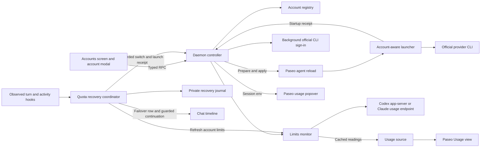
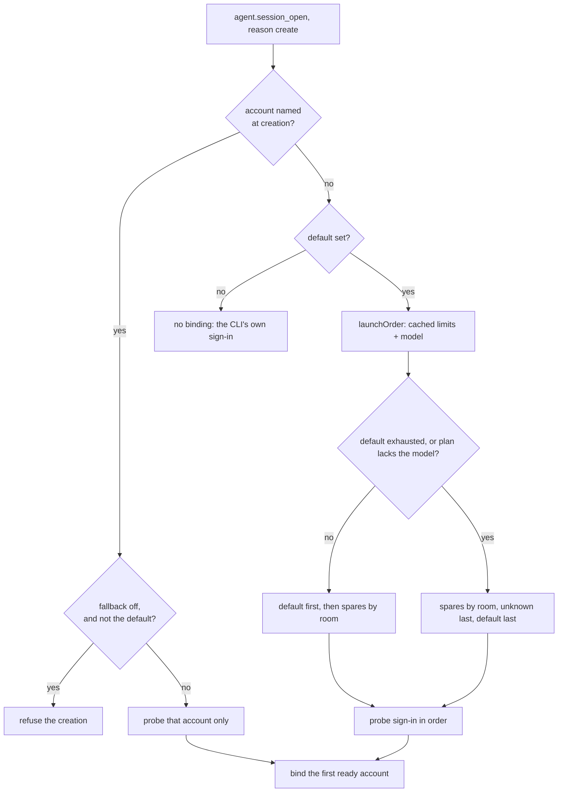
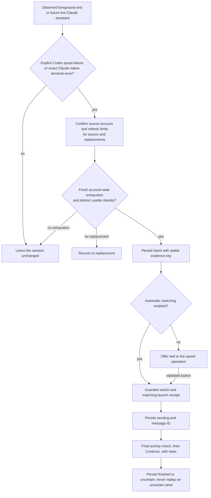

# Architecture and data

[Back to the README](../README.md)

Account Switcher is an independent plugin for Paseo 0.15.3 and newer on both daemon and connected clients. The development SDK remains pinned to 0.15.4. Source comparison with 0.15.3 found the plugin client/protocol implementation and the hook, timeline, send and reload contracts used here unchanged apart from package versions, so the shared daemon/client manifest minimum is 0.15.3. No Paseo core patch is required. Claude quota evidence additionally reads private CLI transcript fields verified with Claude Code 2.1.321; unknown shapes are rejected, not inferred from prose. Existing screen and usage-source feature checks remain defensive fallbacks, rather than a promise of support for older hosts.

## Runtime boundaries

- `index.client.tsx` and `client/` provide React Native UI, host-themed components, the composer chip, the host's modal, and the timeline rows. TanStack Query caches are scoped to the selected daemon.
- `client/screens.ts` registers the Accounts screen. It uses `addScreen` and, for the sidebar row, `addSidebarHeaderItem` with the host's `SidebarRow`; when the app lacks either, it uses the deprecated `addSurface` or `addSidebarItem` for that part. Each choice is a feature check on the app object, not a version comparison. The Command Center item opens the screen with `openScreen`, or `openSurface` on an app without it. Both paths show the same component.
- `index.server.ts` and `server/controller.ts` register RPCs, agent lifecycle hooks (`agent.create`, `agent.session_open`, `agent.created`, turn start/end, permissions, close and archive), and the usage source. The controller owns profiles, login reservations, switching, integration, and monitoring.
- `server/continuation.ts` coordinates evidenced quota recovery; `continuation-observation.ts` owns live directory/timeline subscriptions, `continuation-timeline.ts` identifies the foreground terminal assistant, `claude-quota.ts` verifies its native parent chain, and `continuation-ledger.ts` persists operation state. These services take testable host/store boundaries.
- `shared/contracts.ts` defines validated RPC inputs, outputs, and public state. It does not import client or server runtime code.
- `server/launcher-main.ts` is bundled into a standalone Node launcher by `npm run build`. The generated `server/launcher-artifact.ts` is a build output, not a file to edit.

Plugins run with the daemon user's permissions. An account profile separates authentication; it is not an operating-system sandbox. Settings and session data are intentionally shared.

## Accounts and profiles

Each provider has a **system** account that references its existing CLI home and a set of plugin-managed accounts with separate homes. System accounts cannot be deleted. Ordinary settings are sourced from the provider home saved during command discovery, including supported `CLAUDE_CONFIG_DIR`, `CLAUDE_SECURESTORAGE_CONFIG_DIR`, and `CODEX_HOME` paths.

| Provider | Isolated per managed account | Shared with the source profile |
| --- | --- | --- |
| Claude | Credentials, OAuth identity metadata, and the profile-specific macOS Keychain namespace | Ordinary settings and MCP configuration; skills, commands, agents, plugins, rules, instructions, `projects`, and `file-history` |
| Codex | File-based `auth.json` and OAuth identity metadata | Ordinary configuration and instructions; skills, rules, memories, plugins, sessions, archived sessions, writer locks, temporary session data, and SQLite home |

Shared directories use links; selected configuration files are copied or merged when preparing a profile. Unchanged contents are not rewritten. Claude's profile-local project trust and history metadata are preserved while ordinary shared configuration is merged.

Managed environments remove authentication overrides and select the intended home. Conflicting API-key, provider, or endpoint settings are rejected. Missing or redirected managed homes fail rather than falling back to another account.

## Integration and switching

Enabling integration saves the original Claude and Codex commands and configures Paseo to invoke the plugin's launchers. Discovery resolves the real CLI first, so launchers do not recursively invoke themselves. A provider whose CLI cannot be resolved is marked unavailable and keeps its Paseo command; the registry records which providers integration owns, so installing the missing CLI later leaves the others integrated until **Enable** adds it. Discovery fails only when neither CLI resolves. The plugin checks command ownership again at runtime. External command changes disable integration and invalidate outstanding startup tokens; restoring the wrapper path alone does not re-enable it.

An agent binding records its confirmed current account separately from its pending selection and requested launch account. **Prepare** changes only the selection. **Apply** verifies identity and idle state, reserves a launch token, and uses Paseo's native reload against the same agent and daemon.

The launcher chooses the assigned profile and writes a startup receipt containing the matching account and launch token. The controller confirms the switch only after reload succeeds and the receipt matches. For ordinary manual switching, a failure after the binding enters `switching` triggers an attempt to restore the previous profile; a refusal before that point changes nothing. A guarded quota recovery uses the cancellation rules below instead of issuing a rollback reload that could interrupt new user work. A failed rollback or interrupted switch leaves the account unconfirmed instead of displaying an assumed account.

A new agent's binding stays unconfirmed (`currentAccountId` null) until a receipt check confirms its launch account: the receipt names that account and launch token, and the agent's session is `idle` or `running`. `controller.snapshot` runs the check for every binding as the app polls `accounts.list`; `controller.accountOf` runs it for one agent when failover or a switch note needs that agent's account, so an agent started with no app open (a schedule, a heartbeat, `paseo run`) is confirmed too. For failover the check also accepts an agent in `error`: Paseo sets that status when a turn fails, before `agent.turn_ended` fires, and the launcher wrote the receipt when it started the CLI, so the receipt still names the account the agent started on. The two status lists are passed to the shared check explicitly.

Paseo reports no failed creation, so `reconcileDeletedAgents` treats a new agent's binding that never appeared as a creation under way until `creationOver` says otherwise. That takes two proofs. `CREATION_WAIT`, 10 minutes from `boundAt`, has passed, which covers the time until the CLI starts and reads the binding, because a CLI started after the binding is gone runs on the system login. And the launcher's receipt names no process that still runs, because a creation can hang with its CLI alive and using the profile; no receipt means no CLI started, and an unreadable one keeps the binding. A PID can pass to another process, after a reboot above all, so `receiptProcessRuns` does not count a process that started after the receipt was written. A binding from before `boundAt` existed starts its wait when first seen. A launcher that spent that long preparing the profile reads the registry again before it starts the CLI, and refuses if the binding is gone.

Any binding then goes only when Paseo answers null for the agent itself. The agent list is not enough: it leaves out agents in background workspaces, among others. An error from that lookup keeps the binding.

A provider default is assigned during interactive agent creation, unless the cached limits prove it would fail and the registry's per-provider `fallback` is on (the default; registries from 0.6 read as on). With `fallback` off, only the default is tried. The `agent.create` hook stores the requested model in a private environment variable; Paseo passes that environment to the same agent's first `agent.session_open`, which has the agent ID, binds the agent and removes the variable before the CLI starts.

The creator can name the account instead, with `PASEO_ACCOUNT_SWITCHER_ACCOUNT` in the agent's environment (an account ID, or a name that exactly one account of the provider has). `bindRequested` probes only that account and binds it regardless of limits, or refuses the creation: no such account, `fallback` off with another account as the default, a sign-in in progress (both checked again inside the registry change), an official probe that is not `ready`, integration off for the provider, or a provider other than Claude and Codex. The hook removes the variable from every session open, so neither the CLI nor a later session sees it. A value in a provider's configured environment joins after the hook, so it selects nothing and does reach the CLI. A binding made this way is like any other afterwards; its creation note gives the reason `requested` when the account is not the default.

The choice and each applied switch are recorded as `account-note` plugin timeline rows (`shared/timeline.ts`). A creation note is held until `agent.created`, which Paseo emits after `agent.session_open` once the agent's timeline exists. Rows live in the daemon's in-memory timeline and do not survive a daemon restart; a host that refuses a row only logs it.

Each limit window carries a `scope` from its parser: `account` for windows that stop every request (Claude `five_hour` and `seven_day`, Codex's main `rateLimits` bucket), `model` for a model's own limits, `spend` for extra paid usage. Exhausted means an account-scope window at 100% whose known reset time has not passed, which still holds for a stale reading because use within a window only grows until it resets; or a fresh Codex reading with `ordinaryUsageAllowed: false`. The plan's model list counts only from a fresh reading, and only for a model that at least one account lists. Room is the percent left in the tightest account-scope window still in effect. Only signed-in accounts without a sign-in in progress are spares. Its binding starts unconfirmed until startup is observed. Existing agents keep their bindings. Archived agents retain theirs for resume; cleanup of deleted agents requires a complete, successful agent listing.

From Paseo 0.14 the controller reloads through the SDK's `agents.ref(id).reload()`, which sends the same request as the CLI. On older hosts it runs `paseo agent reload` with the CLI named in `PASEO_CLI`, or with `paseo` from PATH when that is unset or cannot start, and removes the variables Paseo removes before it starts an outside command. A failed reload's exit code and stderr go to `console.error`; only the refusal reaches the chat.

Native reload preserves the native session ID, but does not offer an atomic idle-and-reload operation. Concurrent messages from another client remain a race that callers must avoid. Real switching, compaction, child sessions, and rewind require live acceptance beyond synthetic tests.

## Paseo usage and failover

The session environment and usage source connect existing readings to Paseo's usage UI. Quota recovery has a separate coordinator, strict `recoveryDecision` selector and persistent ledger, with fake host/store boundaries for tests. It does not change cached `launchOrder` selection for new agents or ordinary manual switching.

### Session environment

Paseo's built-in usage sources find an agent's login from that session's launch environment: the Claude source from `CLAUDE_CONFIG_DIR` (it selects the Keychain entry), the Codex source from `CODEX_HOME/auth.json`. The launcher sets those variables only inside its own process, so Paseo would read the default login for every agent.

`server/session-env.ts` (`profileEnv`) gives the `agent.session_open` hook the same variable the launcher uses. For an agent whose binding names a managed account (`launchAccountId`, else `currentAccountId`) of the request's provider, with integration enabled for that provider, it returns `CLAUDE_CONFIG_DIR` or `CODEX_HOME` set to the account's home. The system account, an agent without a binding, and a provider without integration get nothing, because there the CLI runs on the login Paseo already reads. The value is derived on every session open, so a switch, which reloads the agent, moves it with the binding. A failed registry read is logged and costs only this hint. The hook still removes the private model hint.

A managed home links the shared directories to the source home, so other reads of the variable by Paseo see the same settings and sessions.

### The host's Check usage setting

Paseo 0.15 adds a host setting that turns usage checks off, stored as `daemon.usage.enabled` in `config.json`. Paseo's own gate covers its usage requests but not this plugin's collector, so the collector reads the same value before each round and manual refresh. While it is off, the plugin requests nothing, keeps what it already read, and looks at no turn for failover, because an old reading is no proof that an account ran out. Only an explicit `false` counts, so a host without the setting stays on.

### Usage source

`server/paseo-usage.ts` registers a usage source named **Account Switcher** (`id: "account-switcher"`) when `server.registerUsageSource` exists, and does nothing otherwise. Its input is `{ accountId }`, a registry locator and never a credential.

- `discover` answers only the `global` scope: managed accounts that are signed in, not in the middle of a sign-in, and with an `identityKey`. Accounts whose identity equals the same provider's system account are left out, since Paseo's own card covers that login. The key is the Codex account ID, or a Claude identity with `claude:` written `claude-`. A value Paseo would refuse (a character outside `[A-Za-z0-9._-]`, or longer than 128) is replaced by a hash, so no email is exposed. The `session` scope returns nothing: with the session environment in place Paseo's own source reports that account, and a second report would show it twice.
- Known limitation: one managed account can appear twice in the Usage view. Paseo ids a report as `<source id>:<key>`, and its merge adds accounts found through agent sessions to the global list. With the session environment above, opening the usage details of an agent on a managed account lets Paseo's own Claude or Codex source find that login, so the view can show *Claude · email* next to *Account Switcher · Work*. The plugin keeps its source, since cards of different sources cannot be merged from a plugin.
- `fetch` maps the controller's cached snapshot and makes no provider request. `ok` and `stale` give an available report with the plan and one window per reading that has a percentage or a detail (Claude names some limits without data; Paseo's own sources leave those out too), a duration from the reported minutes, a `scope` for model windows, the reading's `detail` as a detail, and account-wide windows marked as the summary. `needs_auth` and `unavailable` give an error with a fixed short message.
- Window ids come from the quota's label, not from the response position. Paseo matches pinned windows by id, and the collectors' own ids are positions (`weekly_scoped:0`, `gpt-5.3-codex-spark:primary`) that shift when a provider reorders its response. The label names the quota; Codex's `· primary` or `· secondary` slot suffix is dropped. Two readings that name the same quota and period get `:2`, `:3` and so on, the only place order enters an id.

### Verified quota interruption and continuation

The foreground path in `ContinuationCoordinator` requires an observed `agent.turn_started` with a stable turn ID. The callback captures its generation and clock synchronously, then reads the session snapshot; a matching `activeTurn.startedAt` is preferred when present. Turns that predate plugin loading, unknown native sessions and ordinary completions do not become recovery candidates just because the limits cache is full. Codex must report an explicit `usage_limit_reached` or `usageLimitExceeded` failure code. Claude may report a native quota stop as either completed or failed, so it requires the independent transcript proof below.

`ContinuationObservation` starts from a legitimate hook/RPC context using the host-owned API. It owns an agent directory subscription including background agents and one live timeline subscription per Claude agent. Initial/restored snapshots establish account, session, model, workspace, cwd, user activity and generation baselines, never candidates. Only future explicit assistant IDs after subscription readiness can enter the coordinator, delayed briefly for native flush and foreground completion. No history/refetch triggers this background path. Native error timestamps must be at least the arm boundary, so a delayed rebroadcast of an older error does not qualify. Latest callbacks replace pending candidates; foreground and background use the same lock, proof, quota checks, switch receipts and send journal.

Directory/ref updates and live activity cancel stale candidates. Replacement, subscription restoration and errors discard the observation and require a newly established subscription plus baseline. A shared foreground/live stop gate keeps cancellation disarmed across timeline replacement, directory restoration, ordinary refresh and autonomous SDK turn/user events; only a fresh host user timestamp or a different native session unlocks it. That tombstone is in memory, so host stops across plugin reload remain an observation limitation. Manual switches and settled automatic operations re-establish the source baseline. Shutdown marks the observer stopped before releasing handles, and late setup completion cannot leak an observation. The exact owned reload permits one close and a same-session `thread_started`; an external or changed-session transition still cancels.

For Claude, `readClaudeTurnMessageId` requests canonical timeline history in bounded pages (at most 20 pages and 2,000 entries). Paseo 0.15.4 returns `projected` history even for that request; its projector preserves assistant entries with distinct explicit message IDs. The reader selects only the final assistant by sequence, with the current turn ID, Claude provider and an unambiguous message ID. A later user message, missing ID, different turn/provider, changed epoch, incomplete page or pagination gap stops the check. It never falls back to an earlier assistant error. User message IDs cannot be the native anchor because Paseo may replace them with client IDs.

`readClaudeQuota` opens only the bound profile's exact native session JSONL, reads at most the last 8 MiB and checks that the regular file did not move or change during the read. The latest native parent branch must end in the structured assistant error `isApiErrorMessage: true`, `error: "rate_limit"`, with `apiError` absent or `usage_limit_reached`. Its `message.id` or exact outer record UUID must equal the observed public terminal assistant ID. Only a user record with all of `queueTranscriptOnly: true`, `promptSource: "system"`, `origin.kind: "task-notification"`, `origin.producer: "session-task"` and `queueSkipAttachments: true` is skipped while following its parent link; its later flush timestamp is not execution evidence. The chain must reach a real initiating user; sidechains, foreign sessions, broken/truncated branches, later successful answers or inputs, model-credit errors, quoted error text and standalone SDK rate-limit events are rejected. These are private Claude 2.1.321 fields, so unfamiliar formats skip recovery.

`recoveryDecision` requires successful fresh readings (`status: ok`, valid fetched/checked times no more than two minutes old), current account-wide exhaustion, and no remaining paid extra-usage allowance. Recovery refreshes both source and replacements rather than deciding only from cached data. A replacement must be signed in, outside a sign-in operation, use the same provider with a known different identity, and have either known remaining account quota or an authoritative `usageAllowed: true`. Stale, unknown, full and known model-incompatible replacements do not qualify. The original model and native session are preserved. This strict recovery selector is separate from the less restrictive cached fallback policy for creating a new agent.

Claude operations use a stable `(agentId, sessionId, nativeErrorUUID)` key because foreground turn IDs can repeat after reload; Codex retains `(agentId, sessionId, turnId)`. Older Claude records with the same error ID remain deduplicated, and ambiguous legacy sends without an error ID conservatively block replay in that session. Each operation has a hashed timeline row ID. The private `continuation-ledger.json` under the account store records identifiers, identity hashes, timestamps, state and continuation message ID, not conversation bodies or credentials. Writes are serialized and atomic with mode `0600`. States are `intent`, `switching`, `sending`, `finished` and `uncertain`. Loading unfinished records marks them uncertain; neither reload nor duplicate events replay them. Attempts are limited to three per agent in a rolling hour, without returning to an identity left during that hour. Subagents use the same evidence and isolation checks rather than a separate blanket exclusion.

Automatic switching and the quota row's button share the saved operation. Buttons cannot reconstruct an operation from arbitrary account/row IDs; forged, stale and pre-reload offers are refused with a direction to `/account`. The per-agent coordinator claim and `SwitchService` applying lock cover switching, the continuation send and its journal write. `sending` and the message ID are persisted before sending, so an ambiguous failure is never automatically resent. Ordinary **Apply** and `/account` keep their existing selection/rollback behavior and send no continuation.

Turn starts, cancellations, pending permissions, close/archive and snapshot activity invalidate older generations. Provider, model, workspace, native session, last user activity, account identity/generation and idle state are checked after important awaits, immediately before reload, after the matching launch-token receipt and before sending. A single close may belong to this operation's own reload; only that owned boundary permits known transient opening statuses. Receipt and send checks again require idle/error with no active turn or pending permission. A canceled recovery does not perform a second rollback reload; uncertainty remains visible for manual account confirmation. Deactivation stops pending work before closing the controller.

The row remains `account-failover`, version 1, with the existing display states and optional fields for old history. New resumable offers carry `resumes: true` and refer to the persisted operation. Rows are still best-effort daemon timeline entries; durable records prevent replay but do not recreate old UI history after restart.

Paseo 0.15.4 offers no atomic idle/session compare-and-send or compare-and-reload operation. Final checks plus `activeTurnBehavior: "steer"` avoid intentionally interrupting a new turn, but another client's input can still arrive in the final RPC gap and receive a continuation. An idle stop without a cancellation event can have the same observation gap. The plugin cannot promise a cross-client transaction; manual inspection remains necessary after uncertainty.

## Sign-in

The daemon runs the official provider CLI under the managed profile. Claude uses its native subscription login; Codex uses app-server login with browser or device-code mode. The plugin accepts only the expected official authorization URL formats and keeps temporary links and codes in memory.

A persisted reservation prevents another sign-in or account switch while a process may still use the profile. Completion requires the matching process receipt and an identity check. Cancel stops the process before releasing the reservation; uncertain termination keeps the account reserved for recovery. Reload cleanup stops active sign-ins.

The UI uses the public host modal and clipboard API. In the Electron desktop app, it keeps the Paseo 0.8-compatible copy-link flow: users paste the link into their ordinary browser. Web uses a new browser tab; native mobile uses React Native Linking. Automatic opening or copying is best effort, with explicit buttons and selectable text as fallbacks. Codex browser callbacks require a browser on the daemon machine; device-code login works from another device.

## Limits and identity

The monitor checks every account every five minutes. A visible UI renews a 90-second lease, reducing the interval to 60 seconds. A passed reset time schedules another check without fabricating new values. At most two account workflows run concurrently, with one per account. Provider backoff applies to manual refresh too; `Retry-After` takes priority and other retries increase to a maximum of 30 minutes.

Codex limits come from a short-lived official app-server process using `account/read` and `account/rateLimits/read`. Claude uses the OAuth usage endpoint with the selected profile's credentials; on macOS, it follows that profile's Keychain/file precedence. No collector creates a model turn. Credential refresh is left to the official CLI: when identity verification for a limits check finds an expired Claude access token, it first runs `claude -p /usage --no-session-persistence` under that account, at most every 10 minutes per account, so the proof and the request cover the renewed token.

Identity checks bracket collection. The cache can retain stale data only when its identity remains verified; replacement or unknown credentials cannot inherit another account's limits. Restored disk data stays hidden until identity verification. Retry deadlines are in memory and reset when the monitor restarts.

The [monitor reference](../server/usage/README.md) documents credential fingerprints, token rotation, parsing, and scheduling in more detail.

## Stored data

The root is `$PASEO_HOME/account-switcher`, or `~/.paseo/account-switcher` by default. It contains the registry, managed profile homes, generated launchers, startup/sign-in receipts, the last-success limits cache, and the private recovery operation journal. Plugin-created directories use `0700`; registry/cache files use `0600`, and launchers use `0700`.

The registry includes account labels, identity metadata, original commands, defaults, per-provider fallback and automatic-failover choices, and bindings. Access and refresh tokens stay in provider-owned credential storage. They are not returned through plugin RPCs or written to the limits cache. The sign-in RPC exposes only the temporary authorization information needed for that attempt.

Deleting a managed account removes its local profile and its exact Claude Keychain item where applicable. Shared provider history remains. Removing the Paseo plugin installation does not remove this separate data directory. Back it up as private authentication-related data; do not attach it to public issues.
